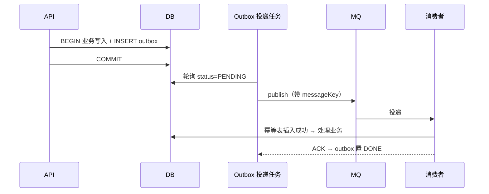

# 小说平台「Novel」总体设计与实施计划

> v0.1 · 2026-11-02
> 已确认前提：**只做后端 API**、**模块化单体**、**平台方供内容**、**先跑通核心**、**简历/作品集定位**

---

## 0. 一句话

一个小说平台后端：**能搜、有榜、可评分评论、用户有书架和主页、社区可发帖并引用小说**。

## 1. 边界

### 1.1 本期做（8 个功能）

| # | 功能 | 交付物 |
|---|---|---|
| F1 | 用户注册登录 | 账号密码 + JWT 双令牌 + Redis 令牌白名单 |
| F2 | 小说/章节阅读 | 详情、目录、正文、上下章、分类筛选、批量导入工具 |
| F3 | 搜索 | ES + IK 中文分词、高亮、筛选、多种排序、搜索建议 |
| F4 | 推荐榜单 | 日/周/月/总榜，热度公式 + 三层缓存 + 防刷 |
| F5 | 评分 | 1–5 星、一人一票、平均分、星级分布 |
| F6 | 书级评论区 | 主评论 + 两层回复 + 点赞 + 排序 |
| F7 | 社区 | 发帖（可引用小说卡片）、帖子点赞、评论、最新/最热 |
| F8 | 用户侧 | 书架（含阅读进度）+ 用户主页 + 统计 |

### 1.2 本期不做（设计上留好口子）

支付/会员/打赏、站内信通知、举报与人工审核队列、作者创作后台、管理后台、个性化推荐算法。

> ⚠️ **一个例外建议**：留 3 个 `/admin/**` 接口（删评论、封用户、置顶帖子），藏在 `ROLE_ADMIN` 后面。
> 成本约 2 小时，但没有它，评论区和社区一出现脏数据你只能手改数据库——演示时会很难看。

## 2. 技术选型：保留什么、改什么

### 2.1 结论表

| 组件 | 你的建议 | 我的结论 | 关键理由 |
|---|---|---|---|
| JDK | 17 | ✅ 保留 | Spring Boot 3.x 硬性要求 17+ |
| Maven | 有 | ✅ 保留 | 4 模块多模块工程 |
| MySQL | 8 | ✅ 主库，**连正文也放这儿** | 见 2.2-① |
| Redis | 可选 | ✅ **必上**，但不止做缓存 | 5 种用途，性价比最高 |
| RabbitMQ | 暂用 | ✅ 保留，**限定 3 个场景 + 必须配 Outbox** | 见 2.2-③ |
| Elasticsearch | 可以 | ✅ 保留，但**它是副本，不是主库** | 见 2.2-② |
| MinIO | 存储 | ✅ 保留，但**只存二进制资产** | 见 2.2-① |
| Spring Boot | — | 3.x（JDK17 兼容的最新小版本，锁 BOM） | — |
| ORM | — | MyBatis-Plus（不用 JPA） | 见 2.3 |
| 认证 | — | Spring Security 6 + JWT（不用 Sa-Token） | 见 2.3 |
| 必备补件 | — | Flyway、SpringDoc、Testcontainers、ArchUnit、JMeter | 作品集的"工程味"全靠这几个 |

### 2.2 我要说服你的四件事

**① 小说正文不要放 MinIO —— 这是唯一一条我建议你改设计的**

| 维度 | 放 MySQL | 放 MinIO |
|---|---|---|
| 阅读延迟 | 一次主键查询，1–3 ms | HTTP + 签名 + 反序列化，10–50 ms |
| 一致性 | 与小说表在**同一事务**（章节数、字数、更新时间同步） | 跨系统，必须写补偿逻辑 |
| 能不能查 | 能按章节号、字数、时间直接 SQL | 不能，只能按 key 取 |
| 改错字/修订 | 一条 UPDATE | 重新上传对象 + 版本管理 |

正文正确的位置是 `chapter_content.content MEDIUMTEXT`（**单独拆表**，别和 `chapter` 挤一起，避免列表查询把大字段拖进 buffer pool），热点章节再套一层 Redis。

MinIO 留给它真正擅长的东西：**封面、头像、导入的 TXT/EPUB 原文件、社区配图、数据库冷备**。用 S3 协议（AWS SDK v2）而不是 MinIO 专用 SDK，将来换 OSS/S3 只改配置。

**② ES 值得留，但你必须承认"同步成本"**

如果只是"能搜到标题"，MySQL 8 自带的 `ngram` 全文索引就够，还能少一个中间件。ES 真正的价值在这四件事，MySQL 都给不了或要自己造：

1. **中文分词质量**（IK 把「诛仙」和「仙侠」切开的方式和人不一样）
2. **相关度排序**（BM25 + 字段权重：标题×3、作者×2、简介×1）
3. **高亮 + 聚合筛选**（分类/状态/字数区间的 facet 统计）
4. **搜索流量不压主库**

代价是：**ES 里的数据随时可能落后 1–2 秒，甚至因为消费失败而缺一条**。所以定死一条铁律：

> **MySQL 是唯一真相，ES 只是可重建的索引副本。** 任何"读自己刚写的数据"的场景走 MySQL，不走 ES。

配套三件套：索引别名（`novel_v1` → 别名 `novel`，重建时零停机）、Outbox 增量同步、每日全量重建 + 对账。

**③ MQ 要用对，重点不是"用上了"，而是"用得不脏"**

只用在三个真有异步价值的地方：

| 场景 | 为什么必须异步 |
|---|---|
| ES 索引同步 | 搜索不该拖慢发帖/更章的响应时间 |
| 榜单与统计聚合 | 阅读、点赞这类高频写，聚合要削峰 |
| （预留）通知 | 本期不做，但拓扑先留好 |

**反模式警告（这条是面试高频考点）**：不要在 `@Transactional` 方法里直接 `rabbitTemplate.convertAndSend()`——事务回滚了消息却已发出，或者提交后进程挂了消息就丢了。正确做法是 **本地消息表（Outbox）**：



消费端用 `(message_key, consumer)` 唯一索引做幂等，失败进死信队列，重试 3 次指数退避。

**④ 不要碰分库分表**

数据量撑不到那个级别，硬做只会暴露设计缺陷。把精力换成这些更诚实、更好讲的点：合理索引 + 慢查询治理、大字段拆表、热点缓存、计数异步落库、**只读查询走从库（预留）**。

### 2.3 我替你否掉的方案

| 方案 | 否决理由 |
|---|---|
| Spring Cloud 微服务 | 单机 7 GB 内存跑不动 Nacos+Gateway+5 个服务；简历上"我拆了微服务"远不如"我知道为什么现在不拆" |
| Kafka | 延迟高、运维重。RabbitMQ 的路由和死信对你这个量级更合适 |
| JPA / Hibernate | 榜单、聚合、多表 join 会写出一堆 N+1；MyBatis-Plus 的 SQL 可控、分页/逻辑删除/乐观锁开箱即用 |
| Sa-Token | 确实更快，但 Spring Security 6 是面试高频、生态最全。**用 Spring Security，把它当学习目标** |
| MongoDB 存章节 | 又多一个中间件，且正文用不上文档模型的灵活性 |

## 3. 架构：模块化单体

```
novel/
├── pom.xml                 聚合 POM
├── novel-common/           统一响应 R<T>、错误码、异常、工具、鉴权注解
├── novel-core/             领域模型 + 应用服务 + 端口接口（不依赖 Web/中间件）
├── novel-infra/            MyBatis Mapper、Redis、MQ、ES、MinIO 适配器
└── novel-api/              Controller、配置、启动类、定时任务
```

依赖方向：`api → core ← infra`，`common` 被三者依赖。**用 ArchUnit 把这个方向焊死**，谁反向依赖就构建失败。

`novel-core` 内部按业务域分包，域内三层：

```
com.novel.core
├── user/{application,domain,port}
├── novel/{application,domain,port}      小说、章节、分类
├── reading/{application,domain,port}    书架、进度
├── review/{application,domain,port}     评分、书评
├── community/{application,domain,port}  帖子、评论
├── search/{application,domain,port}     搜索
└── rank/{application,domain,port}       榜单
```

请求链路：

```
Client → Filter(traceId/限流) → Security(JWT) → Controller → ApplicationService
                                                              ├─ MySQL (MyBatis-Plus)
                                                              ├─ Redis  (缓存/榜单/计数)
                                                              ├─ MinIO  (预签名 URL)
                                                              ├─ ES     (只读搜索)
                                                              └─ Outbox → RabbitMQ → 消费者
```

## 4. 数据模型（约 20 张表）

### 用户域

| 表 | 关键字段 | 说明 |
|---|---|---|
| `user` | username(uk)、password_hash、phone、email、status、created_at | 认证主体 |
| `user_profile` | user_id(uk)、nickname、avatar_key、bio、gender、birthday | 展示信息拆表 |
| `user_stat` | user_id(uk)、bookshelf_count、review_count、post_count、like_received | 冗余统计，MQ 异步更新 |

### 小说域

| 表 | 关键字段 | 说明 |
|---|---|---|
| `novel` | title、author_name、cover_key、category_id、status、intro、word_count、chapter_count、latest_chapter_id、latest_update_at、rating_sum、rating_count、avg_rating、view_count、favorite_count、review_count | 核心表，**冗余一堆计数字段**，避免首页 join 聚合 |
| `novel_category` | name、parent_id、sort_no | 两级分类 |
| `novel_tag` / `novel_tag_rel` | tag.name / (novel_id, tag_id) | 多对多标签 |
| `chapter` | novel_id、seq、title、word_count、is_free、created_at，**uk(novel_id, seq)** | 目录用，不含正文 |
| `chapter_content` | chapter_id(pk)、content MEDIUMTEXT | **正文单独表**，见 2.2-① |

### 阅读域

| 表 | 关键字段 | 说明 |
|---|---|---|
| `bookshelf` | user_id、novel_id、group_id、sort_no、last_chapter_seq、last_read_at，**uk(user_id, novel_id)** | 书架即"收藏 + 进度" |
| `bookshelf_group` | user_id、name、sort_no | 分组（本期只做默认分组） |

### 评分/评论域

| 表 | 关键字段 | 说明 |
|---|---|---|
| `novel_rating` | novel_id、user_id、score(1–5)，**uk(novel_id, user_id)** | 一人一票，重复提交=修改 |
| `novel_review` | novel_id、user_id、content、score(可空)、like_count、reply_count、status、created_at | **书级总评论区的主楼** |
| `review_reply` | review_id、user_id、parent_reply_id、content、like_count、status | 楼中楼，只渲染两层 |
| `like_record` | user_id、target_type(review/post/post_comment)、target_id，**uk(target_type,target_id,user_id)** | 点赞统一表 |

### 社区域

| 表 | 关键字段 | 说明 |
|---|---|---|
| `post` | user_id、title、content、cover_key、view_count、like_count、comment_count、hot_score、status | 帖子 |
| `post_novel_ref` | post_id、novel_id、sort_no、**ref_text(正文里的占位锚点)** | **结构化引用**，见 5.5 |
| `post_comment` | post_id、user_id、parent_comment_id、root_id、content、like_count | 同上两层结构 |

### 榜单 / 基础设施域

| 表 | 关键字段 | 说明 |
|---|---|---|
| `novel_rank` | period、rank_date、novel_id、rank_no、score，**uk(period,rank_date,novel_id)** | 榜单快照，读接口只读它 |
| `outbox` | event_type、payload(JSON)、status、retry_count、next_retry_at，idx(status,next_retry_at) | 本地消息表 |
| `mq_consume_log` | message_key、consumer，**uk(message_key, consumer)** | 消费幂等 |

### 索引要点

```sql
-- 首页/分类列表
idx_category_status_update (category_id, status, latest_update_at DESC)
-- 榜单候选
idx_word_count (word_count)
-- 书评列表按时间
idx_novel_created (novel_id, created_at DESC)
-- 帖子的最新/最热
idx_created (created_at DESC) / idx_hot (hot_score DESC)
-- 标题不做索引，搜索走 ES
```

## 5. 六个核心功能怎么做

### 5.1 搜索（F3）

**索引结构**（别名 `novel` → `novel_v1`）

| 字段 | 类型 | 说明 |
|---|---|---|
| title | text (ik_max_word) | boost 3，带 `title.suggest` completion |
| author_name | text (ik_max_word) | boost 2 |
| intro | text (ik_smart) | boost 1 |
| category / tags / status | keyword | filter + 聚合 |
| word_count / avg_rating / popularity | integer/float/long | 排序与区间筛选 |
| latest_update_at | date | 排序 |

**查询**：`multi_match(title^3, author_name^2, intro)` → filter → sort（相关度/最新/最热/评分）→ highlight → `from/size`；深分页（>1000）切 `search_after`。

**同步**：写路径只入 Outbox，消费者做 `ES upsert`（带 `version` 字段，旧版本丢弃）→ **每日 02:00 全量重建到 `novel_v2` 再切别名** → 抽样对账。

**坑**：IK 插件版本必须与 ES 版本**完全一致**；`vm.max_map_count` 要调到 262144；Spring Boot 的 ES 客户端版本受 BOM 管理，容器版本要**以 BOM 里的客户端版本为准**，不是随便拉 latest。

### 5.2 榜单（F4）

**热度公式**（对数平滑 + 时间衰减，防止老书永远霸榜）：

```
行为量 = 1 + log10(1+阅读人数) + 3×log10(1+收藏数) + 2×log10(1+书评数) + 10×log10(1+总获赞)
热度   = 行为量 / (距最近更新小时数 + 2)^1.5
```

**三层结构**（这是能讲的重点）：

1. **实时层** Redis ZSET：`rank:novel:{daily|weekly|monthly|all}`，用户行为异步 `ZINCRBY` 累加
2. **归档层** 定时任务（每小时）算分 → 写 `novel_rank` 快照；日榜 00:05 落昨日榜
3. **读取层** 接口读快照 + Caffeine 本地缓存 5 分钟（`rank:novel:daily` 这种 key 天然适合）

**防刷**：阅读计数按 `(user, novel, 天)` 去重后入 Redis HyperLogLog；同一 IP 的一批请求只计一次；冷启动书权重降权。

### 5.3 评分（F5）

```
PUT  /novels/{id}/rating  {score:1..5}   -- 幂等，重复提交即修改
GET  /novels/{id}/rating  -> {avg, count, myScore, distribution:{5:12,4:8,...}}
```

- 事务内：`upsert novel_rating` + **增量更新** `novel.rating_sum/rating_count`（新增才 +count，改分只调 sum）
- `avg_rating` 写冗余列（`DECIMAL(3,2)`），避免每次除法；分布图用 Redis Hash 计数
- **自愈**：每日定时 `UPDATE novel SET rating_sum=(SELECT SUM(score)...)` 兜底，防止并发累加漂移
- **防刷**：注册满 7 天 或 有 ≥3 章阅读记录才可评分；这比"任何人都能打 1 星"健康得多

### 5.4 书级评论区（F6）

- 两层模型：`novel_review`（主楼，可带星级可长文）+ `review_reply`（楼中楼但只渲染两层，用 `root_id` 归并）
- 排序：最热（赞数 + 时间衰减）/ 最新 / 只看有评分
- **点赞**：Redis Set 去重 + `HINCRBY` 计数，定时批量落库；读取时 `count = DB 值 + Redis 增量`
- 删除：软删除 + 计数修正；一楼被删但楼中楼保留时显示"该评论已删除"
- **正文安全**：本期只做 DFA 敏感词拦截/替换，不做审核队列

### 5.5 社区（F7）——引用小说的正确姿势

**不要**让用户在正文里粘贴 `https://.../novels/123` 然后后端正则解析。**要**用结构化引用：

```
POST /posts  {
  "title": "...", "content": "这段写得太好了，[[ref:0]] 第 30 章直接封神",
  "refNovels": [{"novelId": 123}]
}
```

后端把 `refNovels` 存进 `post_novel_ref`，正文里只留占位符 `[[ref:0]]`。渲染时替换成小说卡片（封面/书名/作者/评分）。好处：小说改名改封面自动同步、链接不会失效、不会被伪造、能反查"哪些帖子提到这本书"。

其余：`post` 的点赞/评论结构与书评复用同一套（`like_record` + 两层评论），**列表按最新/最热两路排序**，最热用 ZSET 同一套机制。

### 5.6 书架与用户主页（F8）

- 书架 `uk(user_id, novel_id)`；加入时记录 `last_chapter_seq`
- **阅读进度高频写**：每翻一页就 update 数据库会写放大 → 进度先写 Redis Hash `progress:{userId}`，每 30 s / 退出时批量落库
- "有更新"标记：`novel.latest_chapter_id != bookshelf.last_chapter_id`（列表接口顺手算出来）
- 主页 = `user_profile` + `user_stat` + 最近书评/帖子各 5 条；统计字段靠 MQ 事件增量更新，**不要每次 count(*)**
- 越权红线：`PUT /users/me` 只能改自己；`DELETE /reviews/{id}` 校验 `user_id` 属于当前登录人（这是最容易被扫描器打穿的地方）

## 6. 工程质量（作品集真正加分的地方）

| 维度 | 做法 | 产出 |
|---|---|---|
| 响应契约 | 统一 `R<T>{code,message,data,traceId}`，错误码分段（1xxx 业务 / 4xxx 参数 / 5xxx 系统） | `docs/api-error-code.md` |
| 参数校验 | `@Validated` + 自定义约束（评分 1–5、分页 size ≤ 50） | — |
| 鉴权 | Spring Security 6 过滤器链 + `@PreAuthorize` + 资源归属校验 | — |
| 幂等 | 唯一索引兜底 + 必要处 Redis `SETNX` | — |
| 限流 | Redis Lua 令牌桶：登录 5 次/分/IP，发帖 10 条/时/用户 | — |
| 缓存三防 | 随机 TTL 防雪崩、空值缓存防穿透、热点 key 本地缓存防击穿 | — |
| 日志 | MDC traceId 全链路 + JSON 格式 + 慢 SQL（>200ms）打印 | — |
| 监控 | Actuator + Micrometer + Prometheus：QPS、P99、缓存命中率、MQ 堆积 | Grafana 截图 |
| 测试 | 单测（JUnit5+Mockito）、集成（Testcontainers 起 MySQL/Redis）、契约（MockMvc）、架构（ArchUnit） | 覆盖率 ≥ 50% |
| 压测 | JMeter 三个场景：搜索、章节阅读、书评列表 | `docs/benchmark.md`（含 p99 曲线） |
| CI | GitHub Actions：`mvn -B verify` + 镜像构建 | 绿色徽章 |

## 7. API 一览（RESTful，`/api/v1`）

| 域 | 接口 |
|---|---|
| 认证 | `POST /auth/register` `POST /auth/login` `POST /auth/refresh` `POST /auth/logout` |
| 用户 | `GET/PUT /users/me` `GET /users/{id}` `GET /users/{id}/stats` |
| 小说 | `GET /novels` `GET /novels/{id}` `GET /novels/{id}/chapters` `GET /novels/{id}/chapters/{seq}` |
| 搜索 | `GET /search?q=&category=&sort=&page=&size=` · `GET /search/suggest?q=` |
| 榜单 | `GET /ranks?period=daily|weekly|monthly|all&limit=50` |
| 评分 | `PUT /novels/{id}/rating` `GET /novels/{id}/rating` |
| 书评 | `GET/POST /novels/{id}/reviews` `DELETE /reviews/{id}` `POST /reviews/{id}/like` `GET/POST /reviews/{id}/replies` |
| 书架 | `GET/POST /bookshelf` `DELETE /bookshelf/{novelId}` `PUT /bookshelf/{novelId}/progress` |
| 社区 | `GET/POST /posts` `GET/DELETE /posts/{id}` `POST /posts/{id}/like` `GET/POST /posts/{id}/comments` |
| 文件 | `POST /files/presign`（返回 MinIO 预签名上传 URL） |

约定：分页统一 `PageResult{list,total,page,size,hasNext}`；排序参数 `sort=hot|latest|rating`。

## 8. 里程碑（全职约 3 周 / 业余 5–6 周）

| # | 里程碑 | 内容 | 工期 | 验收标准 |
|---|---|---|---|---|
| M0 | 骨架 | docker-compose 起 5 个中间件、4 模块 POM、Flyway、统一响应、Swagger、traceId | 2d | `mvn verify` 绿，`/swagger-ui` 可访问，一个 Testcontainers 用例通过 |
| M1 | 认证 | 注册/登录/刷新/登出、JWT 白名单、限流、异常体系 | 3d | Postman 全集通过；无 token 访问受保护接口返回 401 |
| M2 | 内容 | 小说/分类/章节 + **导入工具** + 阅读接口 + 书架 | 4d | 导入 500 本/2 万章，章节接口 P99 < 20 ms |
| M3 | 评分书评 | 评分聚合、书评 CRUD、回复、点赞计数 | 3d | 并发打分 1000 次后 `avg = sum/count` 不漂移 |
| M4 | 搜索 | ES 索引+IK、全量重建、Outbox 增量、高亮/筛选/排序 | 4d | 写完 2 s 内可搜到；重建期间搜索不断服 |
| M5 | 榜单 | 热度公式、ZSET、定时快照、防刷 | 3d | 榜单刷新任务可手动触发；重复阅读不重复计分 |
| M6 | 社区 | 帖子、结构化引用、点赞、评论、最新/最热 | 3d | 帖子引用小说卡片可回显；热帖排序 5 min 内生效 |
| M7 | 收尾 | ArchUnit、压测报告、CI、架构图、README、面试讲稿 | 4d | 一份能直接讲的 10 页 PPT + 3 个可复现的压测数据 |

**如果时间不够，按这个顺序砍**：榜单热帖 → 搜索建议 → 书架分组 → 社区最热排序。**M0/M1/M4 不能砍**。

## 9. 风险清单

| 风险 | 影响 | 对策 |
|---|---|---|
| 本机 7 GB 内存跑 5 个中间件 | ES 起不来 / OOM | compose `profiles` 分组启动；ES `-Xms512m -Xmx1g`，单节点，关 xpack security |
| ES 与 Spring Boot 客户端版本不匹配 | 启动即报错 | 以 BOM 里 `elasticsearch-java` 版本为准去拉容器；IK 插件版本与之**完全一致** |
| 小说文本版权 | 不能公开演示 | **只用公版书**（四大名著、聊斋）或自造数据，README 注明来源 |
| 章节太大（单章 20 万字） | DB 行溢出、Redis 大 key | 导入时校验单章 ≤ 1 万字；正文不进缓存列表，只缓存正文 |
| 搜索结果"慢半拍" | 用户看不到自己刚改的标题 | 详情/列表读 MySQL，搜索读 ES；对账任务兜底 |
| 时间被 UI 细节吃掉 | 交付不了 | 本期只做后端；`/swagger-ui` 就是你的演示界面 |

## 10. 环境准备（当前机器实测）

| 项 | 状态 | 要做的 |
|---|---|---|
| JDK 17 | ❌ **没装**（`java` 不存在，`JAVA_HOME` 为空） | `sudo apt install openjdk-17-jdk`，或 sdkman |
| Maven | ❌ 未安装 | `sudo apt install maven`（或装 wrapper，推荐 `mvn wrapper:wrapper`） |
| Docker | ✅ 29.6.1，守护进程正常 | 镜像走 `docker.1ms.run/` 镜像站 |
| 内存 | ⚠️ 7 GB 总 / ~5 GB 可用 | ES 限 1 GB 堆；用 profiles 按需启动 |
| 磁盘 | ✅ 900 GB 可用 | — |
| 网络 | ✅ 走代理可达 Maven 中央仓库 | `~/.m2/settings.xml` 配镜像/代理 |
| 端口 | 需避开已占用：3000、5432 | 规划：3306 / 6379 / 5672+15672 / 9200 / 9000+9001 |

## 11. 待你拍板（4 个小问题）

1. **分类体系**：用两层分类（玄幻→东方玄幻）还是单层 + 标签？我默认**两层分类 + 标签**。
2. **导入数据源**：公版书文本（我建议）还是 LLM 批量造 500 本假数据？后者更快、无版权风险。
3. **管理接口**：接受我加 3 个 `/admin/**` 兜底接口吗？（约 2 小时成本）
4. **要不要从第一行代码就开始写中文注释 + 设计文档**？作品集项目我建议要，边写边攒素材。

---

**下一步**：你确认上面 4 个问题（或直接说"按默认来"），我就开始 M0——生成 POM、compose、骨架代码，并先把 JDK 17 和 Maven 装好。
